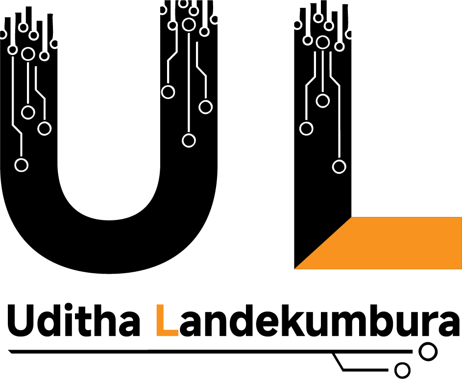

<p align="center">
  <picture>
    <source media="(prefers-color-scheme: dark)" srcset="assets/logo-dark.png">
    
  </picture>
</p>

<h1 align="center">Hands-On C++</h1>

<p align="center">
  <a href="LICENSE"></a>
  <a href="LICENSE-CONTENT"></a>
  
</p>

*A brain-friendly handbook for learning C++, from your first line of code to a complete multi-file project.*

Written by **Uditha Landekumbura**.

Hands-On C++ teaches programming through a story. Amaya, a first-year computing student, builds a management system for her Uncle Ruwan's grocery shop, adding one feature per chapter. Every chapter mixes short explanations with puzzles, quizzes, code magnets, "Be the Compiler" exercises and hands-on labs.

## Editions

| Edition | File | Best for |
|---|---|---|
| Interactive web book | `Hands-On_Cpp_Handbook.html` | Reading on a laptop or phone, with clickable quizzes, code magnets and hidden solutions |
| PDF book (A4, about 330 pages) | `Hands-On_Cpp_Uditha_Landekumbura.pdf` | Printing and offline reading, with all solutions at the back |

Both files are attached to each [release](../../releases). They are built from the same source, so the content is identical.

## What the book covers

| Part | Chapters |
|---|---|
| **Foundations** | 1 Thinking Like a Programmer · 2 Hello, C++ · 3 Variables, Data Types and Constants · 4 Talking to the User · 5 Operators and Expressions |
| **Control flow** | 6 True or False? · 7 Making Decisions · 8 Loops |
| **Organising code and data** | 9 Functions · 10 References, Scope and Recursion · 11 Arrays and Vectors · 12 Strings and Characters · 13 Searching and Sorting · 14 Structs and Enums · 15 Pointers and Memory |
| **Real programs** | 16 Working with Files · 17 Building a Real Project |
| **Appendices** | A C++ Cheat Sheet · B Compiler Error Decoder · C Glossary |

All code uses standard **C++17**.

## Every example is tested

The book contains about 240 C++ code blocks. `make verify` extracts them, compiles every complete program with `g++ -std=c++17 -Wall -Wextra`, runs them with the keyboard input shown in the book, and checks that the output matches the book exactly, including files that programs write. The same check runs automatically on every pull request.

## Repository layout

```
content/      Chapter sources in Markdown (one file per chapter)
capstone/     Ruwan Stores Manager, the Chapter 17 project, as a standalone program
assets/       Logo and other images
tools/        Build scripts: Markdown to web and PDF, and the code verifier
.github/      CI workflows and the pull request template
```

## Building from source

Requirements: Python 3.10+, Node.js 20+, g++ with C++17 support, and `pdfinfo` (from poppler-utils).

```bash
make setup     # install Python and Node dependencies and the Chromium renderer
make verify    # compile and run every example
make web       # dist/Hands-On_Cpp_Handbook.html
make pdf       # dist/Hands-On_Cpp_Uditha_Landekumbura.pdf
```

To try the capstone project on its own:

```bash
cd capstone
make
./shop
```

## Contributing

Corrections and suggestions are welcome. Please read [CONTRIBUTING.md](CONTRIBUTING.md) before opening a pull request.

## License

This repository uses two licences:

| What | Licence |
|---|---|
| Source code: `tools/`, `capstone/` and the C++ code examples in the book | [MIT](LICENSE) |
| Book content: the text in `content/` and the web and PDF editions | [CC BY-NC-SA 4.0](LICENSE-CONTENT) |

In short, you may share and adapt the book for non-commercial purposes, as long as you credit Uditha Landekumbura and share your adaptations under the same licence. The code may be used for any purpose under the MIT terms.

The author's name and logo (`assets/logo.png`, `assets/logo-dark.png`) are not covered by either licence. All rights in them are reserved.

## Author

**Uditha Landekumbura** · [GitHub](https://github.com/uditha1994) · [LinkedIn](https://www.linkedin.com/in/uditha94)
